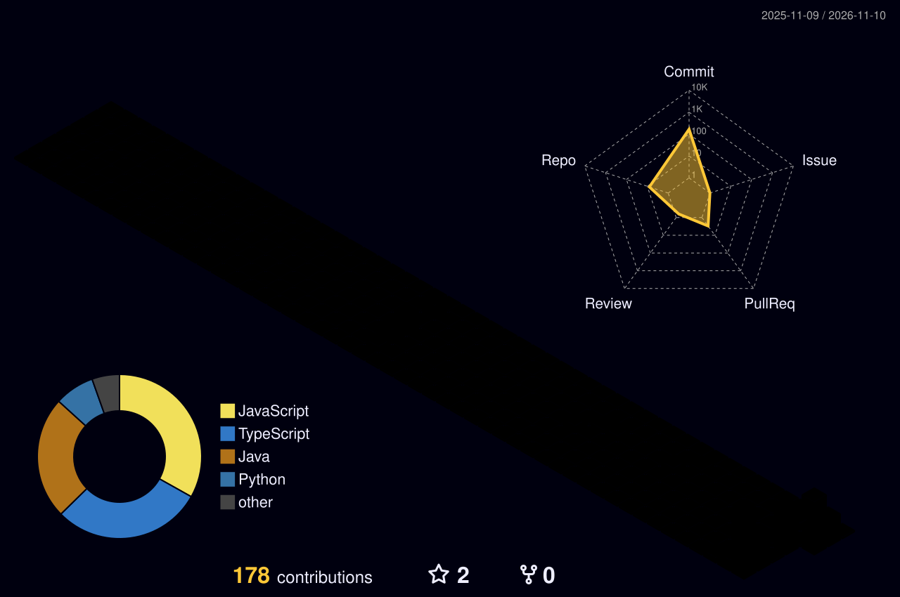

<h3 align="center">DEVADHARSHINI D</h3>

<p align="center">
  <a href="https://github.com/Devadharshini784">
    
  </a>
</p>

<p align="center">
  <i>I turn ideas into things that actually work.<br>
  Clean logic underneath, a smooth interface on top,<br>
  and a habit of always learning something new.</i>
</p>

<p align="center">
  <a href="mailto:devadharshinid44@gmail.com"></a>
  <a href="https://www.linkedin.com/in/devadharshini-d-86071a339/"></a>
</p>

---

### About

```js
const devadharshini = {
  role: "Backend-leaning full stack developer",
  focus: ["Concurrency & system design", "AI / RAG applications", "Security tooling"],
  currentlyLearning: ["Kafka", "Kubernetes", "Prometheus & Grafana"],
  funFact: "I debug by explaining the problem out loud to nobody.",
  lookingFor: "Problems that are hard to get right",
  reachMe: "devadharshinid44@gmail.com",
};
```

---

### Stack

**LANGUAGES**  


**SERVER**  


**DATA**  


**CLIENT**  


**PLATFORM**  


---

### Activity

<p align="center">
  
</p>


<p align="center">
  
</p>

---

### Elsewhere

[devadharshinid44@gmail.com](mailto:devadharshinid44@gmail.com)  ·  [LinkedIn](https://www.linkedin.com/in/devadharshini-d-86071a339/)
